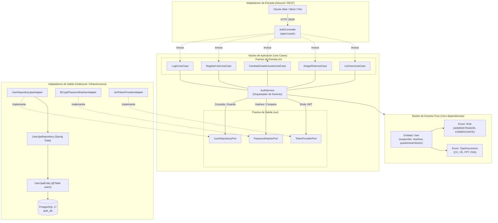
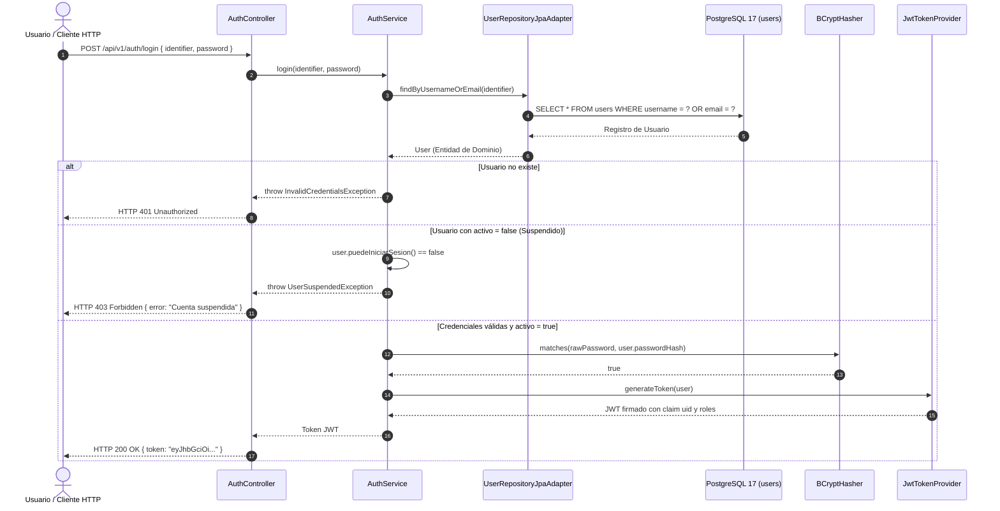

# AuthCore Service - Microservicio de Autenticación y Gestión de Comerciantes

Microservicio desacoplado responsable de la identidad, autenticación y ciclo de vida de usuarios y comerciantes para el sistema de gestión de heladerías **"Coni-Cream"**. Diseñado bajo los principios de **Arquitectura Hexagonal (Ports & Adapters)** y **Domain-Driven Design (DDD)**.

---

## 1. Stack Tecnológico

* **Lenguaje:** Java 25 (Uso intensivo de `record`, Pattern Matching y programación inmutable sin Lombok).
* **Framework:** Spring Boot 4.1.2.
* **Persistencia:** Spring Data JPA + Driver oficial de PostgreSQL.
* **Base de Datos:** PostgreSQL 17 (Ejecución en contenedor Docker efímero con semillero automatizado).
* **Seguridad:** Spring Security 6 (Filtros Stateless) + JJWT 0.12.6 (HMAC-SHA256).
* **Criptografía:** BCrypt con factor de costo 12 (`$2a$12$...`).
* **Construcción y Dependencias:** Gradle con Toolchain integrado.

---

## 2. Diagramas de Arquitectura (Mermaid)

### Diagrama 1: Arquitectura Hexagonal (Puertos y Adaptadores)
Muestra el aislamiento absoluto del Dominio y cómo la infraestructura se conecta únicamente a través de contratos de interfaz.



---

### Diagrama 2: Secuencia del Login Dual con Invariante de Estado (`FEAT-01`)
Muestra cómo se resuelve la búsqueda por `username` o `email` en una sola consulta JPQL y la validación de cuenta activa:



---

## 3. Estructura de Paquetes y Responsabilidades

El proyecto se organiza bajo la arquitectura hexagonal canónica de tres capas:

```text
src/main/java/com/pamplona/authcore/
│
├── domain/                                    # CAPA 1: EL CORAZÓN DEL DOMINIO (Java Puro)
│   ├── User.java                              # Entidad de negocio rica con invariantes (suspender, reactivar).
│   ├── Role.java                              # Enum con roles del negocio: ADMINISTRADOR y COMERCIANTE.
│   └── TipoDocumento.java                     # Enum con documentos legales binacionales (CC, CE, PPT, PAS).
│
├── application/                               # CAPA 2: CASOS DE USO Y ORQUESTACIÓN
│   ├── exception/                             # Excepciones de aplicación (UserSuspendedException, etc.).
│   ├── ports/
│   │   ├── in/                                # Puertos de Entrada (Contratos para los controladores)
│   │   │   ├── LoginUseCase.java              # Caso de uso de autenticación dual.
│   │   │   ├── RegisterUserUseCase.java       # Caso de uso de registro mediante RegisterUserCommand.
│   │   │   ├── CambiarEstadoUsuarioUseCase.java # Caso de uso para suspender/reactivar comerciantes.
│   │   │   ├── AssignRoleUseCase.java         # Asignación de roles administrativos.
│   │   │   └── ListUsersUseCase.java          # Consulta administrativa de usuarios.
│   │   └── out/                               # Puertos de Salida (Contratos para la infraestructura)
│   │       ├── UserRepositoryPort.java        # Contrato de persistencia de usuarios.
│   │       ├── PasswordHasherPort.java        # Contrato para cálculo y comparación de hashes.
│   │       └── TokenProviderPort.java         # Contrato para emisión de tokens de seguridad.
│   └── service/
│       └── AuthService.java                   # Implementación de los casos de uso sin tocar infraestructura.
│
└── infrastructure/                            # CAPA 3: TECNOLOGÍA Y ADAPTADORES EXTERNOS
    ├── adapters/
    │   ├── in/rest/                           # Adaptador Driving (Controlador REST)
    │   │   ├── AuthController.java            # Expone endpoints en /api/v1/auth y /api/auth.
    │   │   ├── GlobalExceptionHandler.java    # Capturador global de errores (400, 401, 403, 404, 409).
    │   │   └── dto/                           # Records inmutables para transporte JSON de request/response.
    │   └── out/
    │       ├── persistence/                   # Adaptador Driven (Base de Datos)
    │       │   ├── UserJpaEntity.java         # Mapeo ORM a la tabla PostgreSQL 'users'.
    │       │   ├── UserJpaRepository.java     # Interfaz Spring Data JPA con consultas JPQL atómicas.
    │       │   └── UserRepositoryJpaAdapter.java # Adaptador que traduce de UserJpaEntity a User de dominio.
    │       └── security/                      # Adaptadores de Seguridad Técnica
    │           ├── BCryptPasswordHasherAdapter.java # Encriptador BCrypt oficial.
    │           └── JwtTokenProviderAdapter.java     # Generador de JWT con claims uid, roles y expiration.
    └── config/                                # Configuración de Spring y Arranque
        ├── SecurityConfig.java                # Cadena de filtros stateless y lista blanca de endpoints.
        ├── JwtAuthenticationFilter.java       # Filtro de interceptación de cabecera Bearer Token.
        └── AdminBootstrapRunner.java          # Creación automática del usuario administrador inicial.
```

---

## 4. Contratos de la API REST

Todos los endpoints están versionados bajo el prefijo `/api/v1/auth` (manteniendo retrocompatibilidad con `/api/auth`):

| Método | Endpoint | Acceso | Descripción |
| :--- | :--- | :--- | :--- |
| **POST** | `/api/v1/auth/login` | Público | Login dual admitiendo `username` o `email`. Retorna JWT. |
| **POST** | `/api/v1/auth/register` | Público | Registro de comerciantes con documento legal (`CC`, `CE`, `PPT`, `PAS`). |
| **GET** | `/api/v1/auth/users` | Admin (`Bearer`) | Lista detallada de comerciantes y administradores registrados. |
| **PATCH**| `/api/v1/auth/users/{id}/estado` | Admin (`Bearer`) | Suspende (`activo: false`) o reactiva (`activo: true`) sin perder historial. |
| **POST** | `/api/v1/auth/users/{id}/roles` | Admin (`Bearer`) | Asigna roles administrativos adicionales a un usuario. |

---

## 5. Despliegue Local con Docker (Base de Datos Efímera con Seed)

El microservicio utiliza **PostgreSQL 17** en un contenedor Docker aislado. La base de datos es **efímera** (no utiliza volúmenes persistentes que ensucien el host) y se inicializa automáticamente ejecutando los scripts en `/docker-entrypoint-initdb.d/`:
* `01_schema.sql`: Crea las tablas `users` y `user_roles`.
* `02_seed.sql`: Carga datos de prueba listos para operar.

### Cuentas Semilla Pre-cargadas para Pruebas:

| Usuario | Correo | Contraseña | Rol | Estado | Propósito de Prueba |
| :--- | :--- | :--- | :--- | :--- | :--- |
| `carlos_comerciante` | `carlos@conicream.com` | `1234` | `COMERCIANTE` | **Activo** | Probar Login Dual por usuario o correo (`200 OK`). |
| `pedro_suspendido` | `pedro@conicream.com` | `1234` | `COMERCIANTE` | **Suspendido** | Probar bloqueo de invariante de dominio (`403 Forbidden`). |
| `admin` | `admin@conicream.com` | `admin123` | `ADMINISTRADOR` | **Activo** | Creado por `AdminBootstrapRunner` para gestionar comerciantes. |

### Comandos de Ejecución:

```bash
# Levantar el entorno completo (Base de datos + Microservicio compilado)
docker compose up -d --build

# Ver logs en tiempo real
docker compose logs -f authcore-service

# Destruir contenedores y limpiar la base de datos por completo
docker compose down
```
